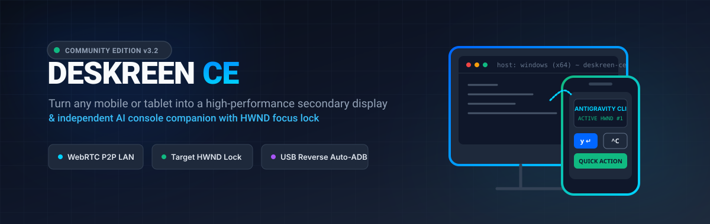
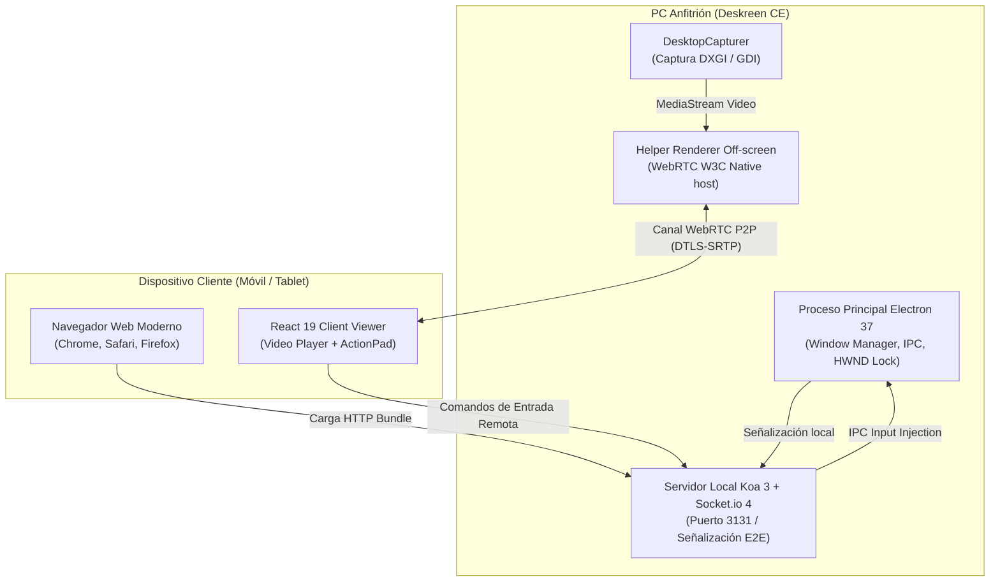

<p align="center">
  
</p>

<p align="center">
  <a href="LICENSE"></a>
  <a href="package.json"></a>
  = 22.6.0" />
  
  
  
  
</p>

<p align="center">
  <strong>Deskreen Community Edition (Deskreen CE)</strong> convierte cualquier teléfono inteligente, tableta o computador con un navegador web moderno en una pantalla secundaria de ultra baja latencia y consola interactiva complementaria para tu computador, a través de red local (Wi-Fi/LAN), cable USB o red mallada privada.
</p>

---

## 1. ¿Qué es Deskreen CE?

**Deskreen CE** es una bifurcación comunitaria activa y modernizada de [Deskreen](https://github.com/pavlobu/deskreen) (creado originalmente por Pavlo Bilida). El proyecto ha sido reconstruido desde sus cimientos sobre el stack contemporáneo de **Electron 37**, **React 19**, **Vite 7**, **TypeScript 5.9** y **WebRTC**, eliminando la deuda técnica de empaquetadores obsoletos y añadiendo capacidades diseñadas para desarrolladores que utilizan múltiples dispositivos móviles como consolas dedicadas para herramientas de IA (Antigravity CLI, Claude Code, Ralph TUI, Aider) y monitores de referencia.

---

## 2. Estado Real del Desarrollo

- **Versión activa:** `1.0.0 (Community Edition)`.
- **Estabilidad de compilación:** Suite nativa de Node.js con **424 pruebas unitarias y de estrés pasando** sin fallas.
- **Auditoría de licenciamiento:** Código abierto verificado bajo **GNU AGPL-3.0** con estricta preservación de avisos de autoría original.
- **Madurez de empaquetado:** Probado y validado en Windows 10/11 x64, macOS (Apple Silicon y x64) y Linux (x64 y ARM).

---

## 3. Problema que Resuelve

1. **Escasez de monitores físicos en movilidad:** Permite aprovechar tabletas (iPad, Android) o laptops secundarias como pantallas adicionales sin comprar monitores portátiles costosos ni cables propietarios.
2. **Interferencia de foco en terminales concurrentes:** Al utilizar dos o más celulares como consolas de desarrollo remoto, las pulsaciones de teclado suelen interferir entre ventanas duplicadas. Deskreen CE resuelve esto vinculando cada celular al identificador nativo de ventana (**HWND Lock**) de su proceso específico.
3. **Fricción de emparejamiento manual:** Elimina la necesidad de aceptar manualmente cada conexión en cada reinicio gracias a la aprobación instantánea configurable y la reconexión automática mediante tokens seguros.

---

## 4. Características Verificadas e Implementadas

- ⚡ **Transmisión WebRTC P2P de Ultra Baja Latencia:** Flujo de video directo entre el anfitrión y el navegador del cliente mediante canales WebRTC con cifrado DTLS-SRTP.
- 🎯 **Target Window Handle Lock (HWND Lock):** Enrutamiento de pulsaciones de teclado directo al identificador nativo de ventana (`HWND` en Win32) o proceso, garantizando que cada consola móvil interactúe con su propia terminal sin desviar el foco global ni colisionar entradas.
- 📱 **Soporte Multi-Dispositivo Simultáneo:** Admite hasta 5 dispositivos clientes conectados en paralelo visualizando monitores o ventanas independientes.
- 🔄 **Conmutación Dinámica de Fuentes (`SWITCH_SOURCE`):** El visor cliente en el celular puede alternar entre pantallas completas o ventanas abiertas directamente desde la interfaz web, sin necesidad de tocar la PC.
- 🔌 **Doble Contingencia USB & Wi-Fi (Auto-ADB):** Detección automática de conexiones USB con `adb reverse` para latencia mínima y conmutación transparente a Wi-Fi si el cable se desconecta.
- 🌙 **Visor Cliente Accesible y Reactivo:** Interfaz libre de distracciones, adaptable a temas claro/oscuro del sistema operativo (`prefers-color-scheme`) y certificada con estándares de contraste WCAG AA (>= 4.5:1).
- 🔒 **Cero Dependencia de la Nube:** Señalización HTTP y WebSocket ejecutada exclusivamente en tu máquina local (`localhost`), sin enviar tráfico a servidores de terceros.

---

## 5. Características en Desarrollo y Hoja de Ruta

- 🌐 **Soporte STUN/TURN Configurable:** Infraestructura opcional para permitir conexiones seguras a través de Internet público fuera de redes VPN malladas (ver investigación en [`docs/investigacion_alternativas_conectividad_remota.md`](docs/investigacion_alternativas_conectividad_remota.md)).
- 🖱️ **Emulación de Puntero Táctil Completa:** Soporte de gestos multi-touch y emulación de mouse absoluto (actualmente optimizado para control de teclado y consolas rápidas).
- 🧩 **Integración Automática de Driver IddCx:** Asistente integrado para la instalación en un clic del controlador de monitor virtual en Windows.

---

## 6. Limitaciones Conocidas (Transparencia Técnica)

> [!IMPORTANT]
> **Sobre la Pantalla Extendida en Windows:**  
> Windows no permite extender el escritorio hacia un monitor que no exista físicamente en el hardware de video. Por tanto, para tener un monitor secundario extendido real (donde puedas arrastrar ventanas fuera de tu pantalla física), es **necesario** utilizar un controlador de pantalla virtual como [`Virtual-Display-Driver`](https://github.com/itsmikethetech/Virtual-Display-Driver) (código abierto, MIT) o un conector físico HDMI Dummy Plug ($4 USD). Sin esto, Deskreen CE puede **compartir ventanas individuales de aplicaciones** o **duplicar pantallas existentes**.

> [!NOTE]
> **Modelo de Red:**  
> En su configuración predeterminada, Deskreen CE opera dentro de la misma red local (Wi-Fi / Ethernet). Para conectar dispositivos móviles mediante datos móviles 4G/5G a través de Internet, ambos dispositivos deben formar parte de una red privada virtual mallada como **Tailscale** (solución gratuita de cero configuración recomendada en nuestra auditoría técnica).

---

## 7. Arquitectura del Sistema



---

## 8. Requisitos del Sistema

- **Node.js:** `>= 22.6.0` (LTS recomendado).
- **npm:** `>= 10.9.0` (definido en `packageManager`).
- **Sistemas Operativos Anfitriones Soportados:**
  - **Windows:** 10 / 11 (64-bit).
  - **macOS:** 12+ (Monterey, Ventura, Sonoma, Sequoia) en arquitecturas Apple Silicon (ARM64) e Intel (x64).
  - **Linux:** Ubuntu 22.04+, Fedora, Debian, Arch Linux (x64 y ARM64).
- **Dispositivos Clientes:** Cualquier dispositivo con navegador web moderno compatible con WebRTC y H.264 / VP8 (iOS Safari 13+, Android Chrome 80+, navegadores de escritorio).

---

## 9. Instalación y Ejecución desde el Código Fuente

El repositorio consta de dos raíces de paquetes (`raíz` y `src/client-viewer`). Ambos deben instalarse:

### 1. Clonar el repositorio
```bash
git clone https://github.com/gtamayoc/deskreen.git
cd deskreen
```

### 2. Instalar dependencias en ambas raíces
```bash
# Instalar dependencias del anfitrión
npm install

# Instalar dependencias del visor cliente web
cd src/client-viewer
npm install
cd ../..
```

### 3. Modo Desarrollo con Recarga en Vivo (HMR)
Inicia concurrentemente el anfitrión Electron y el servidor Vite del cliente web (`:5174`):
```bash
npm run dev
```

### 4. Compilación y Vista Previa de Producción
```bash
# Compilar cliente web, empaquetar Electron y verificar tipos
npm run build

# Iniciar la aplicación empaquetada
npm run start
```

### 5. Generación de Instaladores Binarios por Plataforma
- **Windows:** `npm run build:win` (genera `.exe` en `dist/`)
- **macOS:** `npm run build:mac` (genera `.dmg` en `dist/`)
- **Linux:** `npm run build:linux` (genera `.AppImage` y `.deb` en `dist/`)

---

## 10. Verificación de Calidad y Pruebas

Deskreen CE aplica estrictas puertas de calidad antes de cada confirmación:

```bash
# 1. Comprobación estricta de tipos TypeScript (client-viewer, node y web)
npm run typecheck

# 2. Análisis estático y verificación de formato con Biome
npm run lint

# 3. Suite completa de 424 pruebas unitarias y de estrés (Node native test runner)
npm test
```

---

## 11. Seguridad y Privacidad

- **Cifrado Extremo a Extremo:** Los flujos de video y los canales de datos de control se transmiten cifrados punto a punto mediante el estándar DTLS-SRTP de WebRTC.
- **Sin Telemetría Oculta:** Deskreen CE no envía capturas de pantalla, datos personales ni registros de uso a ningún servidor externo.
- **Aislamiento de Procesos:** La ventana principal de Electron implementa `contextIsolation: true` con scripts de precarga (`preload`) dedicados.
- **Acceso Local Protegido:** Cada sesión genera un código QR o token de sala unívoco; dispositivos no reconocidos no pueden acceder a la transmisión sin autenticación.

Para reportar incidentes de seguridad, consulta nuestra política en [SECURITY.md](SECURITY.md).

---

## 12. Licencia y Atribuciones

Deskreen CE es software libre publicado bajo la **[GNU Affero General Public License versión 3 (AGPL-3.0)](LICENSE)**.

- **Autor y Creador Original de Deskreen:** [Pavlo (Paul) Buidenkov](https://github.com/pavlobu/deskreen) (Derechos de autor originarios 2020-2021 © Pavlo Buidenkov).
- **Mantenimiento y Modernización Comunitaria:** Deskreen Community Edition Contributors.
- **Código Fuente Correspondiente (Sección 13 AGPL):** De conformidad con el artículo 13 de la licencia AGPL-3.0, todo usuario que interactúe remotamente con este software a través de una red informática puede obtener el código fuente completo en [https://github.com/gtamayoc/deskreen](https://github.com/gtamayoc/deskreen).

---

## 13. Relación con el Repositorio Upstream

Deskreen CE es un fork comunitario independiente. No está formalmente afiliado, patrocinado ni certificado por Pavlo Bilida ni por la marca comercial de `deskreen.com`. Las marcas comerciales y logotipos originales pertenecen a sus respectivos titulares. Este proyecto se distribuye con fines de preservación, modernización técnica y desarrollo colaborativo en estricto cumplimiento de la licencia AGPL-3.0.

---

## 14. Comunidad y Soporte

- 🐛 **Reportar un problema:** Abre una incidencia utilizando nuestras [plantillas de reporte de errores](.github/ISSUE_TEMPLATE/).
- 💡 **Proponer una mejora:** Consulta las [plantillas de propuestas](.github/ISSUE_TEMPLATE/).
- 🤝 **Contribuir al proyecto:** Lee nuestra guía de contribución en [CONTRIBUTING.md](CONTRIBUTING.md) y el [Código de Conducta](CODE_OF_CONDUCT.md).
- 🆘 **Obtener ayuda:** Revisa nuestra guía de soporte en [SUPPORT.md](SUPPORT.md).
- 📜 **Historial de cambios:** Consulta los hitos del proyecto en [CHANGELOG.md](CHANGELOG.md).
