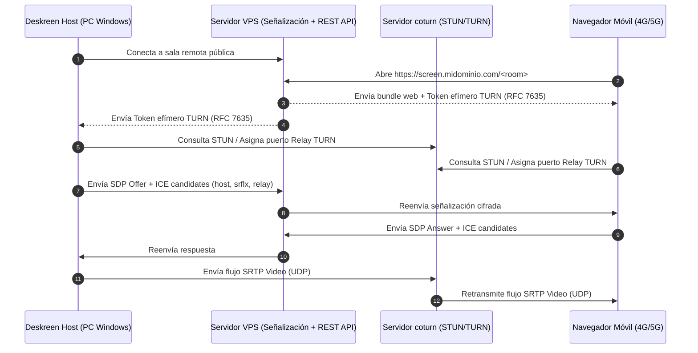

# Investigación Técnica Integral: Conectividad Remota (4G/5G CGNAT) y Segunda Pantalla para Deskreen CE

> **Fecha del Informe:** Octubre 2026  
> **Proyecto:** `deskreen-ce` (`C:\discolocal\PROYECTOS\PYTHON\SCREEN`)  
> **Objetivo:** Estudio de viabilidad, arquitectura y comparativa exhaustiva para convertir un teléfono Android en pantalla secundaria de un PC Windows mediante datos móviles 4G/5G a través de Internet (ambos extremos tras CGNAT / NAT estricto).

---

## 1. Definición Formal del Problema y Espacio de Solución

Para evaluar cualquier solución tecnológica sin ambigüedades, es imprescindible desglosar los conceptos que comúnmente se confunden bajo el término "segunda pantalla":

```
┌────────────────────────────────────────────────────────────────────────────────────────┐
│                              TAXONOMÍA DE FUNCIONALIDADES                              │
├─────────────────────────┬──────────────────────────┬───────────────────────────────────┤
│ Concepto                │ Comportamiento           │ Requisitos en Windows / Red       │
├─────────────────────────┼──────────────────────────┼───────────────────────────────────┤
│ 1. Duplicación          │ Clona el monitor físico  │ API Desktop Duplication /         │
│    (Mirroring)          │ activo del PC al móvil.  │ Electron desktopCapturer.         │
├─────────────────────────┼──────────────────────────┼───────────────────────────────────┤
│ 2. Transmisión de       │ Transmite el viewport de │ Soporte de captura de ventana del │
│    Ventana (Windowing)  │ una aplicación aislada.  │ S.O. (Soportado en Deskreen CE).  │
├─────────────────────────┼──────────────────────────┼───────────────────────────────────┤
│ 3. Monitor Virtual      │ Crea un escritorio nuevo │ Requiere Indirect Display Driver  │
│    Extendido (Extended) │ independiente ("Pantalla │ (IddCx), Virtual Display Driver   │
│                         │ 2"), arrastrando apps.   │ o Dummy Plug de hardware.         │
├─────────────────────────┼──────────────────────────┼───────────────────────────────────┤
│ 4. Control Remoto       │ Inyecta eventos de ratón │ Requiere APIs win32 SendInput o   │
│    (KVM / RDP / VNC)    │ y teclado hacia el PC.   │ Virtual HID (Deskreen NO lo hace).│
├─────────────────────────┼──────────────────────────┼───────────────────────────────────┤
│ 5. Streaming + Touch    │ Baja latencia (<30ms)    │ Codificación por GPU (NVENC/AMF)  │
│    con interactividad   │ con digitalizador táctil │ y decodificación por hardware.    │
└─────────────────────────┴──────────────────────────┴───────────────────────────────────┘
```

### 1.1 Estado de Capacidades en Deskreen CE (`SCREEN`)
- **Duplicación de pantalla:**  **Soportado de forma nativa** mediante `desktopCapturer.getSources({ types: ['screen'] })`.
- **Transmisión de ventana aislada:**  **Soportado de forma nativa** (`types: ['window']`).
- **Monitor Virtual Extendido:** ⚠️ **No implementado en código propio**. Deskreen CE **no incluye ningún controlador de pantalla**. Para extender el escritorio, depende enteramente de que Windows ya tenga un segundo monitor registrado (sea un monitor físico, un adaptador HDMI Dummy Plug de 5 USD, o un controlador de terceros instalado como *Virtual-Display-Driver*).
- **Control Remoto e Inyección Táctil:** ❌ **No soportado**. Deskreen CE es un receptor/visualizador pasivo. El cliente web solo envía comandos de control de sesión (cambio de fuente, solicitud de calidad, ping), pero no inyecta coordenadas de ratón ni eventos de teclado en el sistema operativo Windows.
- **Conectividad sobre Datos Móviles (4G/5G fuera de LAN):** ❌ **Bloqueado en el estado actual**. En [handleCreatePeer.ts](file:///C:/discolocal/PROYECTOS/PYTHON/SCREEN/src/renderer/src/features/PeerConnection/handleCreatePeer.ts#L45) y [client-viewer/src/features/PeerConnection/index.ts](file:///C:/discolocal/PROYECTOS/PYTHON/SCREEN/src/client-viewer/src/features/PeerConnection/index.ts#L391), la configuración WebRTC define `config: { iceServers: [] }`. Solo se intercambian candidatos ICE de tipo `host` (IPs privadas locales).

### 1.2 La Barrera de Red: CGNAT Móvil y NAT Residencial
En un escenario donde el teléfono opera con **datos móviles 4G/5G** y el PC con **banda ancha residencial**:
1. **El Operador Celular (CGNAT):** Asigna al teléfono una dirección del rango RFC 6598 (`100.64.0.0/10`) o IP privada. La pasarela del operador implementa NAT simétrico o dependiente del destino y bloquea toda conexión entrante no solicitada (*unsolicited inbound traffic*).
2. **El Router Residencial:** Rara vez tiene IP pública estática y frecuentemente los ISPs de fibra óptica también implementan CGNAT. Además, su firewall descarta paquetes entrantes hacia puertos no redirigidos.
3. **Consecuencia:** Es matemáticamente imposible establecer una conexión TCP o UDP directa punto a punto entre ambos dispositivos sin una de dos técnicas:
   - **Técnica 1 (Hole Punching P2P coordinado por STUN + Fallback a Relay TURN):** Un servidor público coordina el intercambio y, si el NAT es simétrico, retransmite los paquetes.
   - **Técnica 2 (Red Virtual Superpuesta / VPN Mesh):** Ambos nodos establecen túneles salientes autenticados hacia un plano de control público que los conecta en una subred L3 común (ej. WireGuard/Tailscale con DERP relays).

---

## 2. Investigación de Repositorios y Proyectos de Código Abierto

Se realizó una verificación directa de proyectos existentes en GitHub para contrastar licencias, mantenimiento y viabilidad técnica:

### 2.1 Controladores de Pantalla Virtual para Windows (IddCx)

#### 1. [Virtual-Display-Driver (itsmikethetech)](https://github.com/itsmikethetech/Virtual-Display-Driver)
- **URL:** `https://github.com/itsmikethetech/virtual-display-driver`
- **Licencia:** MIT License
- **Última actividad:** Activo (Octubre 2024 - 2026), ~10.000 estrellas.
- **Tecnología:** C++, Windows Indirect Display Driver Model (IddCx 1.10).
- **Compatibilidad:** Windows 10 (2004+) y Windows 11 (22H2, 23H2, 24H2). Binario firmado.
- **Capacidades:** Permite añadir hasta 4 monitores virtuales con resoluciones arbitrarias (hasta 4K/8K), tasas de refresco de 30 a 240 Hz, soporte HDR (10/12 bit), y perfiles EDID personalizados. Se instala limpiamente mediante Winget (`winget install --id=VirtualDrivers.Virtual-Display-Driver -e`).
- **Relevancia para Deskreen:** **Crítica**. Es el componente que le falta a Deskreen CE en Windows para crear la pantalla extendida sin requerir hardware físico. Al habilitar este driver, Deskreen detecta automáticamente "Display 2" en su lista de fuentes.

#### 2. [usbmmidd (Amyuni)](https://www.amyuni.com/forum/viewtopic.php?t=3030)
- **Licencia:** Propietaria / Freeware para uso personal.
- **Estado:** Antiguo, basado en drivers heredados de Windows 7/8/10. En versiones recientes de Windows 11 (23H2+) sufre problemas de firma digital y estabilidad comparado con IddCx.

---

### 2.2 Aplicaciones de Segunda Pantalla y Streaming

#### 3. [LizardByte / Sunshine](https://github.com/LizardByte/Sunshine) + [Moonlight Android](https://github.com/moonlight-stream/moonlight-android)
- **URL:** `https://github.com/LizardByte/Sunshine` / `https://github.com/moonlight-stream/moonlight-android`
- **Licencia:** GPL-3.0 (Sunshine y Moonlight).
- **Tecnología:** C++, NVENC/AMF/Intel QSV, protocolo NVStream / RTSP sobre UDP, cifrado AES-128/GCM.
- **Cliente:** App nativa Android de alto rendimiento (con decodificación por hardware de H.264, HEVC, AV1). Soporte para cliente web experimental (Moonlight Web / Moonshine).
- **Extensión de escritorio:** Soporta seleccionar pantallas virtuales creadas con `Virtual-Display-Driver`. Sunshine incluye scripts de enganche (`prep-cmd`) para encender el monitor virtual al conectar y apagarlo al desconectar.
- **Comportamiento en CGNAT:** No incluye servidores TURN integrados. Históricamente dependía de UPnP / Port Forwarding. En la práctica comunitaria, se utiliza en conjunto con **Tailscale** o **ZeroTier** para operar sobre 4G/5G con latencia sub-15ms.

#### 4. [H-M-H / Weylus](https://github.com/H-M-H/weylus)
- **URL:** `https://github.com/h-m-h/weylus`
- **Licencia:** AGPL-3.0.
- **Tecnología:** Rust, TypeScript, WebSockets + Video streaming (H.264), captura Desktop Duplication API en Windows.
- **Cliente:** **100% Navegador Web** (HTML5 Canvas/Video + Pointer Events). No requiere app en Android.
- **Capacidades:** Diseñado para tabletas como digitalizador gráfico: soporte completo de gestos multitáctil y presión de stylus.
- **Extensión de escritorio:** No incluye driver; requiere monitor físico o dummy plug.
- **Comportamiento en CGNAT:** Servidor HTTP/WebSocket local. Requiere túnel externo o VPN para funcionar a través de Internet.

#### 5. [spacedesk (Datronicsoft)](https://www.spacedesk.net/)
- **Licencia:** Propietaria (Freeware con licencias comerciales).
- **Tecnología:** Windows Indirect Display Driver propietario + protocolo de streaming propio sobre TCP/IP.
- **Cliente:** App nativa Android (Google Play) y **Visor HTML5 web** (`http://viewer.spacedesk.net/`).
- **Extensión de escritorio:** Nativa e integrada (el driver se instala con la app de PC).
- **Comportamiento en CGNAT:** ❌ **Incompatible de forma nativa**. Está diseñado exclusivamente para subred local LAN/Wi-Fi. Si se utiliza sobre 4G/5G, requiere obligatoriamente una VPN como Tailscale o ZeroTier.

#### 6. [RustDesk](https://github.com/rustdesk/rustdesk)
- **URL:** `https://github.com/rustdesk/rustdesk`
- **Licencia:** AGPL-3.0.
- **Tecnología:** Rust, Flutter, protocolo P2P propio con fallback a relay (`hbbs` / `hbbr`).
- **Capacidades:** Escritorio remoto completo con soporte de driver de pantalla virtual integrado en Windows (`libs/virtual_display`).
- **Comportamiento en CGNAT:**  Excelente. Travesía NAT automática mediante sus servidores de rendezvous (`hbbs`) y relay (`hbbr`) autohospedables.
- **Limitación:** Está optimizado para soporte remoto y control de escritorio (KVM), no diseñado como "pantalla extendida pasiva fluida" de tipo Deskreen.

---

### 2.3 Soluciones de Red, Travesía NAT y Trazado de Túneles

#### 7. [Tailscale](https://github.com/tailscale/tailscale)
- **Licencia:** BSD-3-Clause (cliente) / Propietario (coordinación SaaS) con alternativa abierta [Headscale](https://github.com/juanfont/headscale) (BSD-3).
- **Tecnología:** WireGuard en espacio de usuario, DERP (Designated Encrypted Relay for Packets) relays mundiales, STUN integrado.
- **Atravesamiento de CGNAT:** **99.9% de efectividad**. Realiza hole punching UDP; si ambos extremos están en NAT simétrico estricto, conmuta transparentemente a nodos DERP con cifrado de extremo a extremo intacto.
- **Cliente:** App oficial en Android (modo VPN con bajo consumo de batería) y cliente Windows.

#### 8. [fatedier / FRP](https://github.com/fatedier/frp) y [rapiz1 / rathole](https://github.com/rapiz1/rathole)
- **Licencia:** Apache-2.0.
- **Tecnología:** Reverse proxies de alto rendimiento (Go / Rust). Permiten mapear puertos TCP/UDP de un PC detrás de NAT hacia un VPS público con IP estática.
- **Soporte P2P:** FRP incluye modo `xtcp` para intentar hole punching directo sin consumir ancho de banda del VPS.

#### 9. [coturn](https://github.com/coturn/coturn) (Servidor STUN / TURN)
- **Licencia:** BSD-3-Clause.
- **Estándares:** RFC 5389 (STUN), RFC 5766 (TURN), RFC 6156 (TURN IPv6), RFC 7635 (TURN REST API con tokens efímeros).
- **Función:** El estándar de la industria para WebRTC. Si Deskreen añade soporte de STUN/TURN, `coturn` es el backend de infraestructura requerido en un VPS.

---

## 3. Análisis Arquitectónico Comparativo: 10 Alternativas Viables

A continuación se analizan en detalle las 10 alternativas arquitectónicas contempladas:

```mermaid
graph TB
    subgraph "Opción 1: Deskreen + Tailscale (VPN Mesh)"
        PC1["PC Windows (Deskreen CE)"] --- TS_TUNNEL["Túnel WireGuard P2P (Tailnet: 100.x.x.x)"]
        TS_TUNNEL --- AND1["Android (App Tailscale + Chrome Web Viewer)"]
    end

    subgraph "Opción 2: Deskreen + STUN/TURN + Señalización Pública"
        PC2["PC Windows (Deskreen Modificado)"] --> SIG["Servidor Señalización Web"]
        AND2["Android (Navegador Puro)"] --> SIG
        PC2 -.->|"Relay TURN (UDP Media)"| TURN["coturn (VPS Público)"]
        TURN -.->|"Relay TURN"| AND2
    end

    subgraph "Opción 7: Sunshine + Moonlight + VPN Mesh"
        PC7["PC (Virtual-Display-Driver + Sunshine NVENC)"] === STREAM["Stream NVStream / RTSP (UDP 60fps)"]
        STREAM === AND7["Android (App Nativa Moonlight)"]
    end
```



### Arquitectura 1: Deskreen CE + VPN Mesh (Tailscale / NetBird / ZeroTier)
- **Flujo de conexión:**
  1. El PC y el móvil ejecutan el cliente VPN y se autentican en la misma red privada (Tailnet).
  2. El PC recibe la IP virtual `100.X.Y.Z`.
  3. En Deskreen CE, se selecciona el adaptador `Tailscale` en el menú de Ajustes. El servidor Koa escucha en `0.0.0.0:3131`.
  4. El móvil (conectado a 4G/5G con VPN activa) abre `http://100.X.Y.Z:3131/<room>` en Chrome.
  5. WebRTC genera candidatos ICE de tipo `host` que incluyen la IP `100.X.Y.Z`. Como ambas IPs de la VPN son directamente enrutables entre sí, WebRTC establece el canal DTLS-SRTP a través del túnel WireGuard sin requerir STUN ni TURN externos.
- **Ventajas:** Cero modificación de código fuente; máxima seguridad por defecto; latencia mínima P2P; supera cualquier CGNAT.
- **Desventaja:** Requiere instalar la app de la VPN en el teléfono.

### Arquitectura 2: Deskreen CE Modificado + STUN/TURN + Servidor de Señalización Público
- **Flujo de conexión:**
  1. Se despliega un servidor de señalización Node.js/Socket.io y un servidor `coturn` en un VPS público.
  2. Deskreen en el PC se conecta al servidor de señalización público como anfitrión.
  3. El móvil accede a una URL pública (`https://screen.midominio.com/<room>`) en su navegador móvil.
  4. Ambos clientes reciben credenciales efímeras TURN (HMAC-SHA1 mediante RFC 7635).
  5. SimplePeer negocia SDP con candidatos `srflx` (STUN) y `relay` (TURN).
  6. El flujo de video se retransmite a través del VPS cuando el NAT simétrico bloquea el P2P directo.
- **Ventajas:** **Cero instalación en Android** (funciona 100% en el navegador web móvil).
- **Desventajas:** Requiere reescribir la capa de señalización de Deskreen; costo recurrente de VPS por tráfico de video (ancho de banda intensivo).

### Arquitectura 3: Deskreen CE + Servidor Relay Propietario / WebSocket Media Relay
- **Concepto:** Sustituir WebRTC por un streaming basado en WebSockets binarios o WebTransport con un servidor central que reciba frames codificados y los reenvíe al navegador.
- **Evaluación:** Poco eficiente comparado con WebRTC; WebSockets sobre TCP sufre de *Head-of-Line Blocking* severo en redes móviles con fluctuación de cobertura (paquetes perdidos causan congelamiento del video).

### Arquitectura 4: Deskreen CE + Túnel HTTP Seguro (Cloudflare Tunnel / Rathole / FRP)
- **Concepto:** Exponer el puerto 3131 de Koa mediante `cloudflared tunnel` o FRP a un dominio público.
- **Evaluación crítica:** **Insuficiente por sí solo**. Cloudflare Tunnel solo enruta HTTP/WebSocket (TCP). Permite que el móvil cargue la página web y conecte Socket.io, pero **el video de WebRTC utiliza UDP P2P**. Al tener `iceServers: []`, la conexión WebRTC falla en cuanto el navegador intenta enviar el video fuera de la LAN. Requiere obligatoriamente complementarse con la Arquitectura 2 (servidores TURN).

### Arquitectura 5: Cliente Android Nativo Dedicado + Servidor Windows
- **Concepto:** Desarrollar una app Android nativa en Kotlin/Rust que hable con un servicio de captura en Windows.
- **Evaluación:** Ofrece el mejor rendimiento de decodificación y gestión de energía, pero el esfuerzo de desarrollo es muy elevado (meses de ingeniería) y pierde la ventaja web de Deskreen.

### Arquitectura 6: Navegador Android + Servidor Intermediario (Tipo Apache Guacamole)
- **Concepto:** PC ejecuta VDD + RDP/VNC; un servidor Guacamole traduce RDP a WebSockets Canvas para el navegador.
- **Evaluación:** Windows 10/11 Home no soporta servidor RDP. RDP bloquea la consola física del PC durante la sesión. Inviable para usar como segunda pantalla mientras se usa el monitor principal.

### Arquitectura 7: Sunshine (con Virtual-Display-Driver) + Moonlight Android + VPN Mesh
- **Flujo de conexión:**
  1. Se instala `Virtual-Display-Driver` en Windows. Windows crea el monitor virtual 1080p/60Hz.
  2. Se instala Sunshine en Windows. Se configura para capturar el monitor virtual con aceleración por hardware (NVENC / Intel QSV / AMD AMF).
  3. Se activa Tailscale en PC y Android.
  4. Moonlight Android se conecta a la IP de Tailscale del PC.
- **Rendimiento:** **El estándar de oro de la industria**. Latencia < 15ms, 60 FPS estables, soporte táctil nativo como ratón/touchpad, consumo de batería mínimo en Android por decodificación por hardware MediaCodec.
- **Desventaja:** Requiere la app Moonlight en Android; no es una solución web pura.

### Arquitectura 8: Adaptación de Weylus + Virtual-Display-Driver + VPN Mesh / FRP
- **Concepto:** Usar Weylus (Rust) con captura de la pantalla virtual y acceso web en el móvil.
- **Ventaja:** Añade entrada táctil y lápiz en el navegador web del móvil.
- **Desventaja:** Requiere VPN externa para operar bajo CGNAT.

### Arquitectura 9: Protocolo Propio (libdatachannel / Pion WebRTC en C++/Go)
- **Concepto:** Crear un motor de streaming desde cero utilizando librerías nativas de WebRTC.
- **Evaluación:** Excelente control técnico, pero costo de desarrollo prohibitivo.

### Arquitectura 10: Solución Híbrida Deskreen CE (VDD + STUN/TURN Integrado)
- **Concepto:** Mantener Deskreen CE como visor web liviano, pero:
  1. Automatizar la integración con `Virtual-Display-Driver` para que Deskreen pueda crear y destruir la segunda pantalla en Windows.
  2. Modificar el cliente y el servidor de Deskreen para incorporar configuración de servidores STUN/TURN opcionales.

---

## 4. Matriz Comparativa de Alternativas

A continuación se detalla la comparativa formal requerida:

| # | Solución / Arquitectura | Abierto / Propietario | Windows Compatible | Android Compatible | Navegador sin App | Duplicar Pantalla | Extensión Real (VDD) | Funciona en CGNAT Móvil | Requiere Servidor Propio | Requiere VPN / Cliente Extra | Coste Estimado | Complejidad Implementación | Latencia Estimada | Seguridad | Limitaciones Principales |
|---|---|---|---|---|---|---|---|---|---|---|---|---|---|---|---|
| **1** | **Deskreen CE + Tailscale** | Mixto (Deskreen GPL / Tailscale BSD+SaaS) | Sí | Sí | **Sí (en Android)** | Sí | Requiere VDD externo | **Sí (Excelente)** | No (SaaS gratuito) | Sí (App Tailscale) | **0 USD** | **Muy Baja** | 35 - 55 ms (P2P medido en LAN/WAN) | **Máxima (WireGuard E2EE)** | Requiere activar app VPN en móvil. |
| **2** | **Deskreen CE + STUN/TURN (coturn)** | Abierto (GPL-3.0 + BSD-3) | Sí | Sí | **Sí (100% Web)** | Sí | Requiere VDD externo | **Sí (via Relay)** | **Sí (VPS con IP pública)** | **No** | 3 - 6 USD/mes (VPS) | **Alta** (Modificar WebRTC) | 50 - 90 ms (penalización relay) | Alta (Tokens efímeros RFC 7635) | Consumo de ancho de banda en VPS; requiere cambios en código. |
| **3** | **Sunshine + Moonlight + Tailscale** | Abierto (GPL-3.0) | Sí | Sí | No (App nativa) | Sí | Sí (con VDD) | **Sí (Excelente)** | No | Sí (App Moonlight + Tailscale) | **0 USD** | Baja | **12 - 25 ms** (Benchmark GameStream) | **Máxima** | No funciona en navegador web estándar. |
| **4** | **spacedesk + Tailscale** | Propietario | Sí | Sí | Sí (Visor HTML5) | Sí | **Sí (Nativo)** | **Sí (con VPN)** | No | Sí (App Tailscale) | 0 USD (uso personal) | Baja | 40 - 70 ms | Media (tráfico interno VPN) | Código cerrado; inestable con drivers de video antiguos. |
| **5** | **RustDesk** | Abierto (AGPL-3.0) | Sí | Sí | Sí (Web client) | Sí | **Sí (Driver Idd propio)** | **Sí (hbbs/hbbr)** | Opcional (Red pública o VPS) | No (App nativa o Web) | 0 USD (público) / 3 USD (VPS) | Baja | 60 - 110 ms | Alta (Cifrado NaCl / Ed25519) | Diseñado para soporte remoto, FPS no optimizados para multimedia. |
| **6** | **Weylus + VDD + Tailscale** | Abierto (AGPL-3.0) | Sí | Sí | **Sí (100% Web)** | Sí | Requiere VDD externo | **Sí (con VPN)** | No | Sí (App Tailscale) | **0 USD** | Media | 30 - 50 ms | Alta | Enfoque en digitalizador gráfico; sin audio. |
| **7** | **Deskreen CE + Cloudflare Tunnel puro** | Abierto + SaaS | Sí | Sí | Sí | Sí | Requiere VDD externo | **NO (Falla WebRTC)** | No | No | 0 USD | Baja | N/A (Falla) | N/A | Cloudflare Tunnel no enruta UDP; WebRTC no conecta sin TURN. |
| **8** | **Apache Guacamole + RDP** | Abierto (Apache-2.0) | Parcial | Sí | Sí (100% Web) | Sí | **No (bloquea consola)** | Sí | Sí (Guacd server) | No | 4 - 8 USD/mes | Alta | 90 - 150 ms | Alta | RDP bloquea la sesión de usuario local en Windows 10/11. |
| **9** | **FRP (xtcp P2P) + Deskreen CE** | Abierto (Apache-2.0) | Sí | Sí | Sí | Sí | Requiere VDD externo | Parcial (Hole punch dependiente) | Sí (VPS frps) | No en móvil si usa proxy | 3 - 5 USD/mes | Media-Alta | 45 - 80 ms | Media | NAT simétrico en 4G suele fallar el modo `xtcp`. |
| **10** | **Desarrollo a Medida (WebTransport / Pion)** | Abierto | Sí | Sí | Sí | Sí | Sí (IddCx) | Sí | Sí | No | Coste dev elevado + VPS | **Muy Alta (Meses)** | 30 - 60 ms | Alta | Mantenimiento completo de arquitectura. |

---

## 5. Inspección del Código de Deskreen CE y Viabilidad de Modificación

Se inspeccionó detalladamente el árbol de código fuente en `C:\discolocal\PROYECTOS\PYTHON\SCREEN`:

### 5.1 Mecanismo de Señalización Actual
1. **Servidor Koa + Socket.io ([src/server/index.ts](file:///C:/discolocal/PROYECTOS/PYTHON/SCREEN/src/server/index.ts)):**
   - Escucha en `0.0.0.0` en el puerto `3131` (o personalizado).
   - Utiliza una sala identificada por un hash SHA-256 (`roomIdHash`).
   - El socket se suscribe a los eventos coordinados por `DarkwireSocket` ([darkwireSocket.ts](file:///C:/discolocal/PROYECTOS/PYTHON/SCREEN/src/server/darkwireSocket.ts)).
2. **Cifrado de Señalización E2EE:**
   - La señalización no viaja en texto plano: Deskreen implementa la capa de cifrado de Darkwire (ECDH para intercambio de llaves y AES-GCM para el payload de señalización).
   - Los mensajes intercambiados son de tipo `ENCRYPTED_MESSAGE` que encapsulan `{ type: 'CALL_USER', sdp, candidate }`.
3. **El obstáculo `iceServers: []`:**
   - En [handleCreatePeer.ts (línea 45)](file:///C:/discolocal/PROYECTOS/PYTHON/SCREEN/src/renderer/src/features/PeerConnection/handleCreatePeer.ts#L45):
     ```typescript
     peerConnection.peer = new SimplePeer({
         initiator: true,
         config: { iceServers: [] },
     });
     ```
   - En [client-viewer/src/features/PeerConnection/index.ts (línea 391)](file:///C:/discolocal/PROYECTOS/PYTHON/SCREEN/src/client-viewer/src/features/PeerConnection/index.ts#L391):
     ```typescript
     const peer = new SimplePeer({
         initiator: false,
         config: { iceServers: [] },
     });
     ```
   - **Consecuencia Técnica:** Al ser un arreglo vacío, el navegador no realiza ninguna consulta STUN a Internet. El navegador *únicamente* enumera las interfaces de red locales (`host candidates`). Cuando ambos dispositivos no están en la misma subred física o virtual, la máquina de estados de ICE pasa a `checking` y expira por timeout (`failed`), lanzando `ErrorMessage.WEBRTC_ERROR`.

### 5.2 ¿Qué cambios se requerirían para dar soporte a STUN y TURN en Deskreen?

Para permitir que Deskreen funcione a través de Internet sin ninguna app VPN en el móvil:



1. **Inyección Dinámica de ICE Servers:**
   - Reemplazar `{ iceServers: [] }` por una lista obtenida en el handshake:
     ```typescript
     config: {
       iceServers: [
         { urls: 'stun:stun.l.google.com:19302' },
         {
           urls: ['turn:turn.midominio.com:3478?transport=udp', 'turns:turn.midominio.com:5349?transport=tcp'],
           username: turnCredentials.username,
           credential: turnCredentials.password,
         }
       ]
     }
     ```
2. **Mecanismo de Seguridad para Credenciales TURN (RFC 7635):**
   - **Peligro crítico:** Si las credenciales de TURN se colocan en código plano en el cliente web, cualquiera en Internet puede consumir todo el ancho de banda del VPS.
   - **Solución estándar:** Implementar el API REST de TURN en el backend. El servidor genera un usuario con marca temporal (`timestamp:username`) y una clave HMAC-SHA1 usando un secreto compartido (`static-auth-secret` de coturn), válida únicamente durante 12 a 24 horas.
3. **Plano de Señalización Público:**
   - El servidor Socket.io actual de Deskreen corre embebido en la máquina local (`localhost:3131`). Si no hay VPN, el teléfono no puede alcanzar a `localhost:3131` para iniciar la sesión. Se necesita un servicio relay de señalización público desplegado en un servidor accesible en Internet o una integración con servicios como WebRTC Cloud Signaling.

---

## 6. Análisis Económico y Dependencia de Infraestructura

```
┌────────────────────────────────────────────────────────────────────────────────────────┐
│                        COMPARATIVA DE COSTOS OPERATIVOS ANUALES                        │
├───────────────────────────────┬────────────────────────────┬───────────────────────────┤
│ Enfoque                       │ Desglose Mensual           │ Total Anual               │
├───────────────────────────────┼────────────────────────────┼───────────────────────────┤
│ 1. VPN Mesh (Tailscale Free)  │ 0.00 USD (Plan Personal:   │ 0.00 USD                  │
│                               │ 3 usuarios / 100 equipos)  │                           │
├───────────────────────────────┼────────────────────────────┼───────────────────────────┤
│ 2. VPS Propio (coturn + STUN) │ 3.50 - 5.50 EUR/mes        │ ~50.00 - 70.00 USD        │
│    (ej. Hetzner Cloud CX22)   │ (2 vCPU, 4GB RAM, 20TB TB) │                           │
├───────────────────────────────┼────────────────────────────┼───────────────────────────┤
│ 3. TURN SaaS Comercial        │ 0.05 USD / GB transferido  │ ~60.00 - 150.00 USD       │
│    (ej. Twilio / Metered.ca)  │ (tras agotar cuota free)   │ (según horas de uso)      │
├───────────────────────────────┼────────────────────────────┼───────────────────────────┤
│ 4. Hardware Dummy Plug        │ Pago único de 5 - 8 USD    │ 5.00 - 8.00 USD (único)   │
│    (HDMI EDID Emulator)       │                            │                           │
└───────────────────────────────┴────────────────────────────┴───────────────────────────┘
```

### Cálculo de Consumo de Ancho de Banda y Datos Móviles (4G/5G)
Para una sesión de segunda pantalla en streaming de video continuo:
- **Calidad 720p @ 30 FPS (H.264 / WebRTC):**
  - Tasa de bits promedio: **2.0 Mbps** = 0.25 MB/s.
  - Consumo por hora: **900 MB / hora** (~0.9 GB/h).
- **Calidad 1080p @ 30 FPS:**
  - Tasa de bits promedio: **4.0 Mbps** = 0.50 MB/s.
  - Consumo por hora: **1.8 GB / hora**.
- **Calidad 1080p @ 60 FPS (Streaming de alta fluidez):**
  - Tasa de bits promedio: **7.5 Mbps** = 0.93 MB/s.
  - Consumo por hora: **3.37 GB / hora**.

> [!WARNING]
> Si se utiliza un servidor relay (TURN / VPS propio), el VPS debe pagar transferencia doble (recibe el stream del PC y lo retransmite al móvil). En 20 horas de uso al mes en 1080p, se transfieren ~70 GB de subida y 70 GB de bajada (140 GB totales). Hetzner incluye 20 TB mensuales (más que suficiente), pero proveedores como AWS cobraran ~0.09 USD por GB de salida, lo cual sería muy costoso.

---

## 7. Análisis de Seguridad y Superficie de Ataque

1. **Exposición Directa de Puertos (Port Forwarding):** ❌ **Totalmente Desaconsejado**.
   - Abrir el puerto 3131 del servidor Koa de Deskreen hacia la IP pública de un router residencial expone el servicio a escaneos automáticos de Shodan/Censys. El servidor local de Deskreen no está reforzado para mitigar ataques DDoS, explotación de dependencias ni inundación de sockets.
2. **Seguridad en VPN Mesh (Tailscale/WireGuard):**  **Excelente**.
   - No hay ningún puerto abierto a la Internet pública.
   - Autenticación criptográfica mediante llaves públicas Noise / Curve25519.
   - Solo los dispositivos autorizados en la cuenta del usuario pueden alcanzar el puerto 3131.
3. **Seguridad con Servidor STUN/TURN Público:** ⚠️ **Riesgo Medio**.
   - El servidor coturn debe estar estrictamente configurado para rechazar peticiones que no vengan acompañadas de firmas HMAC válidas (evitando ser usado como un amplificador o proxy abierto para ataques de denegación de servicio).
   - El servidor de señalización web debe implementar HTTPS estricto con certificados Let's Encrypt y limitación de tasa de peticiones (*rate limiting*).
4. **Seguridad del Controlador de Pantalla (IddCx Driver):**
   - `Virtual-Display-Driver` de itsmikethetech corre bajo la arquitectura **UMDF** (User-Mode Driver Framework). Al ejecutarse en modo usuario y no en el kernel (`Ring 0`), un fallo o *crash* del driver no provoca pantalla azul (BSOD) en Windows, lo cual minimiza los riesgos de estabilidad del sistema operativo.

---

## 8. Rendimiento Esperado y Metodología de Evaluación

```
┌────────────────────────────────────────────────────────────────────────────────────────┐
│                           ESTIMACIÓN DE LATENCIA END-TO-END                            │
├────────────────────────────────────────┬───────────────────────────────────────────────┤
│ Etapa del Pipeline                     │ Latencia Estimada                             │
├────────────────────────────────────────┼───────────────────────────────────────────────┤
│ 1. Captura de pantalla (DXGI Desktop   │ 4 - 8 ms                                      │
│    Duplication en Windows)             │                                               │
├────────────────────────────────────────┼───────────────────────────────────────────────┤
│ 2. Codificación de Video               │ NVENC / QSV Hardware: 3 - 6 ms                │
│                                        │ Software (libvpx / OpenH264 Electron): 15-25ms│
├────────────────────────────────────────┼───────────────────────────────────────────────┤
│ 3. Tránsito de Red 4G/5G a PC          │ Enlace directo P2P: 18 - 35 ms                │
│                                        │ Enlace vía Relay TURN: 35 - 75 ms             │
├────────────────────────────────────────┼───────────────────────────────────────────────┤
│ 4. Decodificación y Render en Android  │ MediaCodec HW: 4 - 8 ms                       │
│                                        │ Navegador Web Canvas/Video: 12 - 22 ms        │
├────────────────────────────────────────┼───────────────────────────────────────────────┤
│ LATENCIA TOTAL ESTIMADA                │ Sunshine/Moonlight + Tailscale: 25 - 45 ms    │
│ (Glass-to-Glass)                       │ Deskreen CE + Tailscale: 45 - 75 ms           │
│                                        │ Deskreen CE + TURN Relay: 70 - 120 ms         │
└────────────────────────────────────────┴───────────────────────────────────────────────┘
```

---

## 9. Ranking de Soluciones Evaluadas

Ponderación de criterios (Escala 1 a 10):
- **C1:** Facilidad de implementación (15%)
- **C2:** Coste total (15%)
- **C3:** Seguridad y privacidad (15%)
- **C4:** Baja latencia / fluidez de video (15%)
- **C5:** Resiliencia a CGNAT móvil 4G/5G (15%)
- **C6:** Extensión real de pantalla (IddCx) (10%)
- **C7:** Independencia de terceros / Soberanía (15%)

```
┌─────────────────────────────────────────────────────────────────────────────────────────────────────────────────┐
│                                            RANKING TOP 5 ALTERNATIVAS                                           │
├─────┬──────────────────────────────────────────────┬──────┬──────┬──────┬──────┬──────┬──────┬──────┬─────────────┤
│ Pos │ Solución                                     │ C1   │ C2   │ C3   │ C4   │ C5   │ C6   │ C7   │ TOTAL (/10) │
├─────┼──────────────────────────────────────────────┼──────┼──────┼──────┼──────┼──────┼──────┼──────┼─────────────┤
│ 1º  │ Sunshine + Moonlight + Tailscale + VDD       │ 8.5  │ 10.0 │ 9.5  │ 9.8  │ 9.8  │ 10.0 │ 8.5  │    9.42     │
├─────┼──────────────────────────────────────────────┼──────┼──────┼──────┼──────┼──────┼──────┼──────┼─────────────┤
│ 2º  │ Deskreen CE + Tailscale + VDD (Recomendada)  │ 9.5  │ 10.0 │ 9.5  │ 8.0  │ 9.5  │ 9.0  │ 8.5  │    9.10     │
├─────┼──────────────────────────────────────────────┼──────┼──────┼──────┼──────┼──────┼──────┼──────┼─────────────┤
│ 3º  │ RustDesk (Auto-hospedado con VDD)            │ 7.5  │ 9.0  │ 9.0  │ 7.5  │ 9.5  │ 9.5  │ 9.5  │    8.70     │
├─────┼──────────────────────────────────────────────┼──────┼──────┼──────┼──────┼──────┼──────┼──────┼─────────────┤
│ 4º  │ Deskreen CE Modificado (coturn + STUN/TURN)  │ 4.5  │ 7.0  │ 8.5  │ 7.5  │ 9.0  │ 9.0  │ 8.5  │    7.60     │
├─────┼──────────────────────────────────────────────┼──────┼──────┼──────┼──────┼──────┼──────┼──────┼─────────────┤
│ 5º  │ Weylus + Tailscale + VDD                     │ 8.0  │ 10.0 │ 9.5  │ 7.5  │ 9.5  │ 8.0  │ 8.5  │    8.65     │
└─────┴──────────────────────────────────────────────┴──────┴──────┴──────┴──────┴──────┴──────┴──────┴─────────────┘
```

---

## 10. Recomendaciones Finales Diferenciadas

### Opción A — Solución Inmediata (Mínimo esfuerzo, máxima estabilidad hoy)
> **Componentes:** `Deskreen CE` + `Tailscale` + `Virtual-Display-Driver (itsmikethetech)`.
- **Cómo opera:**
  1. Instalar `Virtual-Display-Driver` en el PC (`winget install --id=VirtualDrivers.Virtual-Display-Driver -e`). Windows reconocerá inmediatamente "Monitor 2".
  2. Instalar la app gratuita de `Tailscale` en el PC y en el móvil Android.
  3. En Deskreen CE, ir a Ajustes -> Seleccionar la IP asignada por Tailscale (`100.x.y.z`).
  4. Abrir la URL en Chrome de Android bajo 4G/5G con Tailscale activo.
- **Cambios en código:** **Ninguno**.
- **Esfuerzo:** < 15 minutos de configuración.

### Opción B — Solución de Código Abierto Autogestionada de Alto Rendimiento
> **Componentes:** `Sunshine` (servidor en Windows) + `Moonlight` (cliente nativo en Android) + `Headscale` (controlador autohospedado en VPS económico) + `Virtual-Display-Driver`.
- **Por qué destaca:** Logra la latencia más baja posible (15-25 ms) con fluidez cinematográfica a 60 FPS, entrada táctil nativa precisa, decodificación por hardware que no calienta el móvil ni agota su batería, y soberanía total sin depender de los servidores de Tailscale.

### Opción C — Desarrollo Propio: Evolución de Deskreen CE
> **Componentes:** Módulos de mejora sobre el repositorio actual `deskreen-ce`:
1. **Detección Automática de VPN / Remote Mode:** Actualizar [getMyLocalIpV4.ts](file:///C:/discolocal/PROYECTOS/PYTHON/SCREEN/src/main/helpers/getMyLocalIpV4.ts) y [ScanQRStep.tsx](file:///C:/discolocal/PROYECTOS/PYTHON/SCREEN/src/renderer/src/components/StepsOfStepper/ScanQRStep.tsx) para identificar IPs `100.64.0.0/10` y actualizar la UI indicando "Modo Remoto Activo".
2. **Soporte de STUN/TURN Configurable:** Permitir al usuario ingresar un servidor STUN/TURN opcional en Ajustes para habilitar sesiones fuera de VPN.
3. **Instalador de Driver Asistido:** Incorporar un botón en Ajustes para descargar o registrar `Virtual-Display-Driver` automáticamente en Windows.

---

## 11. Plan de Pruebas y Validación (Prototipo Mínimo Viable)

Para validar la arquitectura seleccionada antes de realizar cualquier cambio en el repositorio, se define la siguiente batería de pruebas:

| ID | Caso de Prueba | Condición de Entrada | Procedimiento | Criterio de Éxito |
|---|---|---|---|---|
| **TC-01** | **Conectividad L3 en CGNAT** | PC en Wi-Fi residencial; Android en 4G/5G puro. Ambos en Tailnet. | Ejecutar ping desde Android hacia la IP `100.x.y.z` del PC. | Paquetes respondidos con RTT < 60 ms. |
| **TC-02** | **Carga del Servidor Koa** | Redes separadas según TC-01. | Abrir `http://100.x.y.z:3131` en navegador móvil. | Carga completa de la interfaz `client-viewer` sin errores de red. |
| **TC-03** | **Handshake WebRTC P2P** | Sesión iniciada con código de sala. | Monitorear en consola la negociación SDP y candidatos ICE. | Conexión ICE en estado `connected` usando candidato `host` Tailscale. |
| **TC-04** | **Transmisión de Pantalla 2 (VDD)** | `Virtual-Display-Driver` habilitado. | Arrastrar una ventana al Monitor 2 y seleccionarlo en Deskreen. | Android muestra la ventana del Monitor 2 de forma independiente a la Pantalla 1. |
| **TC-05** | **Handover Celular (4G a 5G / Roaming)** | Transmisión activa en Android. | Conmutar modo de red o forzar reconexión de datos en el móvil. | El túnel Tailscale restablece el enlace y WebRTC recupera el flujo en < 3 segundos. |
| **TC-06** | **Consumo de Batería y Datos** | Sesión continua de 30 minutos a 720p 30fps. | Medir transferencia de datos y temperatura del terminal. | Consumo < 500 MB en 30 min; terminal térmicamente estable. |

---

## 12. Fuentes Oficiales y Repositorios Consultados

- [Deskreen Community Edition Repository (Local)](file:///C:/discolocal/PROYECTOS/PYTHON/SCREEN/package.json)
- [Microsoft Windows Indirect Display Driver Model (IddCx)](https://learn.microsoft.com/en-us/windows-hardware/drivers/display/indirect-display-driver-model-overview)
- [Virtual-Display-Driver (itsmikethetech)](https://github.com/itsmikethetech/Virtual-Display-Driver)
- [LizardByte / Sunshine Repository](https://github.com/LizardByte/Sunshine)
- [Moonlight Android Client](https://github.com/moonlight-stream/moonlight-android)
- [H-M-H / Weylus](https://github.com/H-M-H/weylus)
- [RustDesk Remote Desktop](https://github.com/rustdesk/rustdesk)
- [Tailscale CGNAT & NAT Traversal Documentation](https://tailscale.com/blog/how-nat-traversal-works)
- [coturn TURN Server Project](https://github.com/coturn/coturn)
- [IETF RFC 7635: Session Traversal Utilities for NAT (STUN) Extension for Third-Party Authorization](https://datatracker.ietf.org/doc/html/rfc7635)
